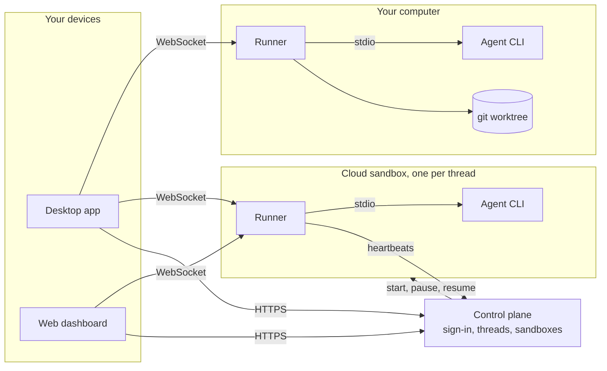

# LemonLime

**Your coding agents keep working after you close your laptop.**

LemonLime runs AI coding agents (Claude Code, Codex, OpenCode, and any agent that
speaks the [Agent Client Protocol](https://agentclientprotocol.com)) on your own
computer or in isolated cloud sandboxes, each on its own git branch. Start a task,
close the lid, and check in from the desktop app or the web dashboard.

<!-- Demo: a 20-second screen recording of starting a thread, approving a command and
     reviewing the diff goes here (docs/demo.gif). -->

## What it does today

- **Your own model account.** Agents run with your Claude, ChatGPT or other login.
  LemonLime never proxies, meters or bills model calls.
- **Never touches your checkout.** Local threads work in their own git worktree on
  `agent/<thread-id>`, so your branch and uncommitted work stay exactly as they were.
  The agent's work is committed to that branch after every turn.
- **You approve the commands.** On your computer, agents edit files freely but ask before
  running anything; you see the exact command and choose Allow or Don't allow.
- **Send while it works.** Messages sent while the agent is busy wait in a queue every app
  can see. A resent message never runs twice.
- **Pick up anywhere.** Each thread keeps an append-only history that any app can resume
  from any point, after a dropped connection or a restart.
- **Cloud sandboxes that pause themselves.** One isolated machine per cloud thread
  (Docker, Daytona or E2B); it pauses after 5 idle minutes and resumes the same
  conversation.
- **Holds up when agents misbehave.** Huge output is trimmed, quiet agents are flagged,
  crashed agents restart once, and sign-in or version problems say how to fix them.
- **Skills for every thread.** Each agent gets LemonLime's skills for git hygiene,
  running tests first, opening pull requests and asking when blocked; add your own.
- **Free and open source (MIT).** Self-hosting is free and unlimited: Cloudflare Workers,
  any Node server, or one Docker Compose command on Ubuntu.

Tested with Claude Code 2.1.302, Codex 0.167.0 and OpenCode 1.18.18
([how we test against real agents](packages/runner/test/fixtures/agents/README.md)).

## How it fits together



Apps talk to each thread's **runner** directly over a WebSocket, so the live
conversation never passes through the control plane. The control plane signs people in,
keeps the thread list, starts and pauses sandboxes, and hands out short-lived tokens.

## What's inside

| Path | What it is |
| --- | --- |
| `packages/protocol` | Schemas and types for every message between app, control plane and runner |
| `packages/runner` | Daemon that runs next to one agent: spawns the CLI, streams events, keeps history and the git branch |
| `packages/sandbox` | Sandbox providers: Docker, Daytona, E2B |
| `packages/client` | WebSocket client with resume, reconnect and safe resends |
| `packages/plugins` | Extension hooks for deployments (defaults allow everything) |
| `packages/db` | Database schema and migrations (SQLite: Cloudflare D1 or a local file) |
| `apps/web` | Control plane and dashboard (Next.js on Cloudflare Workers + D1, or any Node server) |
| `apps/desktop` | Desktop app for macOS, Windows and Linux (Tauri) |

## Quick start: run an agent locally

You need Node 22+, pnpm 11, git, and an agent CLI that is signed in (for example
`claude auth login`).

```bash
pnpm install
cd /path/to/your/repo
LEMONLIME_THREAD_SECRET=$(openssl rand -hex 32) \
  pnpm --dir /path/to/lemonlime runner -- --thread my-first-thread --agent claude-code --source-repo .
```

The runner creates the branch `agent/my-first-thread` in its own git worktree under
`~/.lemonlime/worktrees`, so your checked-out branch and uncommitted work are never
touched. It serves the thread on `ws://127.0.0.1:7420/ws` and commits the agent's
changes to that branch after every turn. The desktop app does all of this for you.

## Self-hosting

```bash
sudo bash scripts/install-ubuntu.sh lemonlime.example.com sign-in@example.com
```

sets up the dashboard, HTTPS and Docker sandboxes on a fresh Ubuntu 24.04 server. See
[Self-hosting](docs/self-hosting.md) for Cloudflare Workers, plain Node and the details.

## Docs

- [Runner](docs/runner.md): command line, queueing, approvals, skills, safety limits
- [Agent plugins](docs/plugins.md): skills, commands, subagents and MCP servers for every thread
- [Self-hosting](docs/self-hosting.md)
- [Contributing](CONTRIBUTING.md) and [security reports](SECURITY.md)

## Contributing

`pnpm check` runs everything CI runs. Read [CONTRIBUTING.md](CONTRIBUTING.md) and
[CLAUDE.md](CLAUDE.md) for the ground rules.

## License

[MIT](LICENSE)
